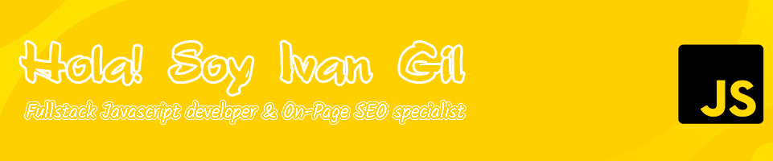

  
**Mis lenguajes y herramientas habituales:**  

<code></code>
<code></code>
<code></code>
<code></code>
<code></code>
<code></code>
<code></code>
<code></code>

**Otros lenguajes y herramientas:**

                             	     
  
### :bookmark_tabs: Algunos sitios que gestiono actualmente
- [ivangil.dev](https://ivangil.dev/)
- [Plataforma](https://plataforma.green/)
- [Ping Pong Technologies](https://pingpongtech.com/)

###  :boy: Más sobre mí:
  
<b>🧑‍🚀 Algunos de mis proyectos individuales</b>

   
  <table>
    <thead align="center">
      <tr border: none;>
        <td><b>💻 Projecto</b></td>
        <td><b>🌟 Estado repositorio</b></td>
        <td><b>👨‍💻 Lenguajes</b></td>
      </tr>
    </thead>
    <tbody>
	    <tr>
	      <td><a href="https://ivangil.dev"><b>🚩 Sitio web Personal</b></a></td>
        <td>Pausado (Privado :lock:)</td>
        <td>
        
        
        
        </td>
      </tr>
	      <tr>
	      <td><a href="https://github.com/ivangil-dev/quantumNode"><b>⚗️ QuantumNode</b></a></td>
        <td>Activo (Privado :lock:)</td>
        <td>
        
        
        </td>
      </tr>
	      <tr>
	      <td><a href="https://github.com/ivangil-dev/CoraAI"><b>📦 Cora AI</b></a></td>
        <td>Inactivo (Privado :lock:)</td>
        <td>
        
        
        </td>
      </tr>
	      <td><b>☕ Portal HHRR</b></td>
        <td>Activo (Privado :lock:)</td>
        <td>
        
        
        </td>
      </tr>
	      <td><b>📱 PWA VR 360º</b></td>
        <td>Activo (Privado :lock:)</td>
        <td>
        
        
        </td>
      </tr>
	      <tr>
	      <td><b>🕹️ Nostalgia MArcade System</b></td>
        <td>Activo (Privado :lock:)</td>
        <td>
        
        
        </td>
	      <tr>
	      <td><a href="https://github.com/ivangil-dev/makeInstaller"><b>📦 mYinstaller</b></a></td>
        <td>Pausado (Privado :lock:)</td>
        <td>
        
        
        </td>
      </tr>
	    <tr>
	      <td><a href="https://github.com/ivangil-dev/ghostplus"><b>👻 Ghost Plus</b></a></td>
        <td>Inactivo (Público :unlock:)</td>
        <td>
        
        </td>
      </tr>
	    <tr>
	      <td><a href="https://github.com/ivangil-dev/Voiceify"><b>🗣️ Voiceify</b></a></td>
        <td>Inactivo (Público :unlock:)</td>
        <td>
        
        </td>
      </tr>
	    <tr>
	      <td><a href="https://github.com/ivangil-dev/absenta"><b>🏞️ Biotica</b></a></td>
        <td>Inactivo (Privado :lock:)</td>
        <td>
        
        
        
        </td>
      </tr>
	    <tr>
	      <td><a href="https://github.com/ivangil-dev/absenta"><b>🌿 Absenta</b></a></td>
        <td>Inactivo (Privado :lock:)</td>
        <td>
        
        
        
        </td>
      </tr>
	    <tr>
	      <td><a href="https://github.com/ivangil-dev/kepler"><b>✈️ Kepler</b></a></td>
        <td>Inactivo (Pausado temporalmente :unlock:)</td>
        <td>
        
        </td>
      </tr>
      <tr>
	      <td><a href="https://github.com/ivangil-dev/linneo"><b>:telescope: Linneo</b></a></td>
        <td>Inactivo (Privado :lock:)</td>
        <td>
        
        
        
        </td>
      </tr>
      <tr>
	      <td><a href="https://github.com/ivangil-dev/sance"><b>:satellite: Sance</b></a></td>
        <td>Inactivo (Privado :lock:)</td>
        <td>
        
        </td>
      </tr>
      <tr>
	      <td><a href="https://github.com/ivangil-dev/sance"><b>:satellite: GhostEvo</b></a></td>
        <td>Inactivo (Privado :lock:)</td>
        <td>
        
        </td>
      </tr>
	    <tr>
	      <td><a href="https://github.com/ivangil-dev/Ghost/tree/5.26.1-castellano"><b>:ghost: Ghost Blog en español</b></a></td>
        <td>Inactivo (Público :unlock:)</td>
        <td>
        
        
        </td>
      </tr>
	    <tr>
	      <td><a href="https://github.com/ivangil-dev/comments-ui/tree/0.12.3-castellano"><b> 🗯️ Comments UI en castellano</b></a></td>
        <td>Inactivo (Público :unlock:)</td>
        <td>
        
        </td>
      </tr>
    </tbody>
  </table>
   
 

	
   
  
<b>⚙️ Mis herramientas y espacio de trabajo :computer:</b>

  	<ul>
  	  <li><b>Sistemas:</b> Ubuntu server 20.04 & Windows 11 Pro</li>
	    <li><b>Portátil: </b> Asus Vivobook 16X</li>
  	    <li><b>Navegador: </b>Chrome Canary & Edge chromium</li>
	    <li><b>Terminal: </b> Hyper & CMD Windows</li>
	    <li><b>Editor favorito:</b> Visual Studio Code</li>
	     
	</ul>

---- 

¡Gracias por visitar mi perfil! 😊
  

👇 ¿Te gusta lo que hago? 👇
 

